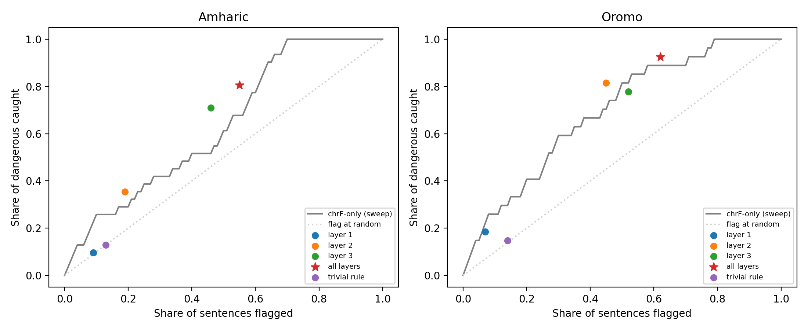

# Can We Trust Machine Translation of Medicine Instructions? (Amharic + Afaan Oromo)

Veritas AI International High School Hackathon 2026, AI + Languages track.

> **This project is a prototype and is not medical advice.** "No red flag" never means "safe". Always confirm medicine instructions with a pharmacist or health worker.

[](https://colab.research.google.com/github/wabix2/medtranslate-guard/blob/main/MedTranslate_Guard_Submission.ipynb))

## In short

- **chrF, the standard automatic score, carries only a moderate safety signal** (AUROC 0.70 for Amharic, 0.77 for Oromo). It is too weak to use alone.
- **Our explainable three-layer gate caught 81% (Amharic) and 93% (Oromo) of dangerous translations on held-out data**, and every flag comes with a human-readable reason. But it flags 55-62% of sentences, which is far too many for real deployment. It is a triage idea, not a finished safety filter.
- **At matched recall the gate gave fewer false warnings than chrF-only, but the difference is not statistically distinguishable from zero** (paired bootstrap, see below). We do not claim the gate beats chrF; we claim it is comparable and explains itself.
- **A learned classifier built by a team member (trained on Round 1 only) did not detectably beat chrF on held-out Round 2.** We report it as a negative result, not as a replacement for the gate.

## Questions

1. Does the standard automatic score (chrF) tell us whether a machine translation of a medicine instruction is safe?
2. Can simple, explainable automatic checks warn a user before they rely on a dangerous translation?

## What we did

- 200 short English medicine instructions in two rounds (S01-S100, S101-S200), four categories: frequency/duration, negation/warnings, quantity, route/condition.
- Translated with NLLB-200 distilled 600M (4 beams) into Amharic (200) and Afaan Oromo (150), then translated back to English.
- Human reference translations, sentence-level chrF.
- Blind safety ratings (0 safe, 1 confusing, 2 dangerous). Two independent Amharic raters (worse rating used), one Oromo rater.
- A three-layer rule-based safety gate with human-readable reasons:
  1. target-language rules (for example repetition loops),
  2. back-translation checks (similarity to the English, changed numbers or negation),
  3. units, conditions, key terms and word coverage.
- Thresholds were chosen on Round 1 only and locked in `locked_thresholds.json` (2026-11-14). Round 2 was scored once. No rule or threshold was changed after Round 1. All analysis below uses the locked thresholds.

## Headline results (Round 2, held out, n = 100 per language)

| | Amharic | Oromo |
| --- | --- | --- |
| Dangerous translations | 31 / 100 | 27 / 100 |
| Dangerous caught by gate | 25 (81%; 95% CI 66-94%) | 25 (93%; 95% CI 81-100%) |
| Sentences flagged | 55% (45-65%) | 62% (53-71%) |
| False warnings, gate | 30 (21-39) | 37 (28-47) |
| False warnings, chrF-only at the same recall* | 36 (25-45) | 46 (25-58) |
| chrF-only minus gate (paired) | +6 (-6 to +16) | +9 (-13 to +22) |
| chrF AUROC for "low chrF = dangerous" | 0.70 (0.58-0.80) | 0.77 (0.67-0.86) |

Confidence intervals are percentile bootstrap intervals over sentences (5,000 resamples; paired for the difference row).

\*The chrF-only baseline picks its flag threshold on the Round 2 labels so that it misses no more dangerous sentences than the gate. That favours chrF, because the gate's thresholds were locked beforehand on Round 1.

**Reading this honestly:** the gate had fewer false warnings than chrF-only in both languages (and in 85% / 67% of bootstrap resamples), but the intervals for the difference include zero. The recall intervals are also wide. With 100 sentences per language, these are early results, not final ones.



*Share of dangerous translations caught vs share of sentences flagged (Round 2). The gray line is chrF-only at every possible threshold; points above it do better than chrF at the same flag rate. The gate (star) sits clearly above the chrF line for Amharic and only slightly above it for Oromo.*

## Which parts of the gate matter

| Gate | Amharic: flagged / recall / false warnings | Oromo: flagged / recall / false warnings |
| --- | --- | --- |
| Layer 1 (target-language rules) | 9% / 10% / 6 | 7% / 19% / 2 |
| Layer 2 (back-translation) | 19% / 35% / 8 | 45% / 81% / 23 |
| Layer 3 (units, conditions, key terms, coverage) | 46% / 71% / 24 | 52% / 78% / 31 |
| **All layers** | **55% / 81% / 30** | **62% / 93% / 37** |
| Simple rule: number or negation differs after round trip | 13% / 13% / 9 | 14% / 15% / 10 |

- The layers are complementary: layer 3 carries most of the recall for Amharic and layer 2 for Oromo, and the union beats every single layer.
- A simple number-and-negation check performed at chance level (flagging 13-14% of sentences and catching 13-15% of dangerous ones). This is a deliberately simple baseline, not the best possible simple rule.
- Layer 3 produces most of the false warnings (24 of the 30 in Amharic). Reducing them without losing recall is the clearest next step.

(`round2/ablation.csv`)

## Do the conclusions depend on which rater we trust?

Amharic has two raters, and the main results use the worse (higher) of the two ratings, the cautious choice for a safety tool. We repeated the analysis with each rater alone:

| Ratings used | Dangerous | Gate recall (95% CI) | False warnings, gate / chrF-only | chrF AUROC |
| --- | --- | --- | --- | --- |
| Worse of two (reported) | 31 | 0.81 (0.65-0.93) | 30 / 36 | 0.69 |
| Rater 1 only | 25 | 0.84 (0.68-0.97) | 34 / 42 | 0.69 |
| Rater 2 only | 20 | 0.90 (0.74-1.00) | 37 / 46 | 0.70 |

The conclusions are stable. But the raters disagree on many individual sentences: only 14 sentences were rated dangerous by both. (`round2/rater_robustness.csv`)

## Where the gate fails

Recall on dangerous sentences by category (caught / dangerous):

| Category | Amharic | Oromo |
| --- | --- | --- |
| Frequency / duration | 2 / 2 | 2 / 2 |
| Negation / warning | 4 / 6 | 4 / 4 |
| Quantity | 7 / 8 | 10 / 10 |
| Route / condition | 12 / 15 | 9 / 11 |

The cells are small, so we do not claim the gate is better or worse in any category.

Examples of dangerous translations the gate **caught** (the first example per category in file order, not hand-picked; full list in `round2/examples.md`):

| id | English | Back-translation | Gate reason |
| --- | --- | --- | --- |
| S124 (Amharic) | Do not use the eye drops while wearing contact lenses. | do not wear eyeglasses when wearing contact lenses. | unit lost: drop; condition lost: while/during; key term lost: eye |
| S171 (Amharic) | Take one lozenge every two hours. | Take one soup every two hours. | back-translation similarity 0.57 < 0.6 |
| S102 (Oromo) | Mix one tablespoon of the powder into a cup of water. | Mix a pot of bread with water. | number/frequency changed; unit lost: tablespoon; low similarity and coverage |
| S120 (Oromo) | Do not use this ointment near your eyes. | Close your eyes close your eyes close your eyes [repeats] | repetition loop; negation missing; negation changed |

Dangerous translations the gate **missed**:

| id | English | Back-translation | What went wrong |
| --- | --- | --- | --- |
| S121 (Amharic) | Do not take this medicine with grapefruit juice. | Do not take this medicine with grapefruit juice. | The round trip is identical to the English, so back-translation cannot see the problem. Rater 1 scored it "confusing" and rater 2 "dangerous" (wrong word). |
| S141 (Amharic) | Let the tablet melt on your tongue. | let the tablet melt on your tongue. | Same round-trip blindness. Only rater 1 scored it dangerous; rater 2 scored it safe. |
| S114 (Amharic) | Put 20 drops in a little water. | 20 put drops in a little water. | Scrambled word order. The coverage check compares sets of words, so it cannot see order. Only rater 2 scored it dangerous. |
| S152 (Oromo) | Keep the medicine in a cool, dry place. | Keep the medicine in a warm, warm place. | A temperature flip. No rule checks for opposite-meaning words. |

All three Amharic misses were rated dangerous by only one of the two raters, so part of the "miss" is label disagreement. The pattern still shows the main weakness: **back-translation by the same model can undo its own mistakes.**

## A learned classifier (a team member's model)

A team member trained a separate classifier: logistic regression on TF-IDF text plus 19 engineered features (number and negation checks, units, LaBSE similarity and others), trained on **Round 1 only** (150 rows: 100 Amharic and 50 Afaan Oromo). Its decision threshold (0.3559) was chosen on Round 1 cross-validation, where it reached 75% recall at about 10% false positives. We evaluated it **once** on Round 2, which it never saw, with nothing retrained or re-tuned (`analysis/ml_round2_eval.py`).

| Round 2, held out | Amharic | Oromo |
| --- | --- | --- |
| Dangerous translations | 31 / 100 | 27 / 100 |
| Recall of dangerous | 61% (95% CI 44-78%) | 56% (36-74%) |
| Sentences flagged | 42% (32-52%) | 29% (20-38%) |
| False warnings | 23 (15-31) | 14 (7-21) |
| *Rule gate, for reference: recall / flagged / false warnings* | *81% / 55% / 30* | *93% / 62% / 37* |
| chrF-only at the same recall: false warnings | 31 (12-42) | 14 (4-27) |
| chrF-only minus learned model (paired) | +8 (-12 to +21) | +0 (-12 to +14) |
| AUROC of the model's probability | 0.73 (0.62-0.83) | 0.73 (0.61-0.83) |
| AUROC, learned model minus chrF (paired) | +0.03 (-0.11 to +0.17) | -0.04 (-0.16 to +0.06) |

- **The threshold did not transfer.** Recall fell from 75% in cross-validation to 61% and 56% on Round 2, and it misses 12 of 31 (Amharic) and 12 of 27 (Oromo) dangerous translations. Round 2 has different sentences and a somewhat higher share of dangerous ones, and 150 training rows is small.
- **It is not distinguishable from chrF.** At the same recall it produced about the same number of false warnings as chrF-only, and its AUROC is within noise of chrF's in both languages.
- **It flags fewer sentences than the rule gate but catches fewer dangerous ones.** These are different operating points, so this table does not show which is better. For a safety tool, missing about half of the dangerous translations is the more serious failure.
- With this much labelled data, a learned model did not beat a single chrF number on held-out sentences. More labelled data, or pretrained multilingual features, would be the next thing to try. Unlike the gate, it also gives no reasons for its flags.

(`round2/ml_results.md`, `round2/ml_predictions.csv`)

## What this means in practice

At a 55-62% flag rate, users would see a warning on most sentences, so this cannot replace a pharmacist or health worker. The realistic use is **triage**: show the reasons, let a person double-check flagged instructions, and treat an unflagged sentence as "no red flag found", never as "safe".

## Files

- `medtranslate_guard.py` - the whole pipeline (translate, score, rating sheets, stats, gate, figures)
- `demo.ipynb` - Colab demo; the first cell installs everything, so it works from a fresh runtime
- **Round 1 (repo root):** `sentences.csv`, `translations_scored.csv`, `translations_rated.csv`, `rating_sheets/`, `figures/`, `results_summary.md`, `provenance.json`
- `locked_thresholds.json` - thresholds locked on 2026-11-14 (shared by both rounds)
- **Round 2 (`round2/`):** `sentences.csv`, `translations_scored.csv`, `translations_rated.csv`, `rating_sheets/`, `figures/`, `results_summary.md`, `provenance.json`
- **Extra Round 2 analysis (locked thresholds, nothing re-tuned):** `analysis/round2_analysis.py` produces `round2/gate_features.csv`, `ci_results.md`, `rater_robustness.csv`, `ablation.csv`, `category_recall.csv`, `examples.md` and `figures/tradeoff_curve.png`
- `ml_classifier.py`, `models/` - the team member's learned classifier (needs `scikit-learn==1.6.1`)
- `analysis/ml_round2_eval.py` - one-shot held-out evaluation of that classifier; writes `round2/ml_results.md` and `round2/ml_predictions.csv`
- `docs/` - one-page write-up (PDF)
- `LICENSE` - MIT (code and our data; third-party models keep their own licenses, see Credits)

## Run

**Quickest:** click the Colab badge at the top. A GPU helps for translating new sentences.

For one-off checks:

```python
import medtranslate_guard as mg
mg.check_instruction("Take one lozenge every two hours.", lang="amharic")
```

To re-score Round 2 from the saved translations and ratings (thresholds stay locked):

```python
import medtranslate_guard as mg
R2 = "round2"
mg.SENTENCES_FILE = f"{R2}/sentences.csv"
mg.SCORED_FILE    = f"{R2}/translations_scored.csv"
mg.RATED_FILE     = f"{R2}/translations_rated.csv"
mg.SHEET_DIR      = f"{R2}/rating_sheets"
mg.FIG_DIR        = f"{R2}/figures"
mg.PROVENANCE_FILE= f"{R2}/provenance.json"
mg.SUMMARY_FILE   = f"{R2}/results_summary.md"
mg.RETEST_N = 0
_orig = mg.add_chrf
mg.add_chrf = lambda df, verbose=False: _orig(df, verbose=False)
mg.main()
```

To regenerate the confidence intervals, ablation, robustness check and examples from the saved data (no translation needed):

```
python analysis/round2_analysis.py
```

To evaluate the learned classifier on Round 2 (downloads LaBSE, about 1.9 GB):

```
pip install "scikit-learn==1.6.1" sentence-transformers sacrebleu
python analysis/ml_round2_eval.py
```

The saved model only loads with scikit-learn 1.6.1, the version it was trained with.

## Credits

NLLB-200 distilled 600M (Meta AI; released under CC BY-NC 4.0, non-commercial), sentence-transformers `all-MiniLM-L6-v2` (rule gate) and LaBSE (learned classifier), sacreBLEU (chrF), scikit-learn. Please check each model's own license before any commercial use. All sentences, reference translations and safety ratings were created by our team. No external datasets and no real patient data.

## Limitations

- **Single Oromo rater.** The Oromo ratings come from one rater, who is also a team member. No one else on the team reads Afaan Oromo, so we cannot report inter-rater agreement for Oromo, and the Oromo results should be read with that in mind.
- **Amharic rater agreement dropped in Round 2** (weighted kappa 0.41 vs 0.73). The main conclusions hold when each rater is used alone (see above), but sentence-level labels are uncertain.
- **Small samples.** 100 sentences per language per round gives wide confidence intervals, and the gate-vs-chrF difference is not statistically distinguishable from zero.
- **Deliberately hard test set.** Dangerous-translation rates here (27-31%) are not real-world rates.
- **Back-translation uses the same model** that made the translation, so it can hide errors (see S121 and S141). We tested only one small model (NLLB-200 distilled 600M).
- **The learned classifier is small and its threshold did not transfer** (150 training rows, Round 1 only); see its section above.
- **High flag rate.** 55-62% of sentences are flagged; the gate is not usable as an automatic filter.
- **Known blind spots:** word-order scrambling (coverage compares word sets) and opposite-meaning words such as "cool" vs "warm".
- The chrF-only comparison baseline is tuned on Round 2 labels (see the note under the results table).

## Future work

- Retrain the learned classifier with more labelled data (including Round 2) and test it on a new Round 3; try combining it with the rule gate's reasons.
- A second independent Oromo rater (ideally a fluent pharmacist or health worker).
- A different back-translation system, or a larger translation model, to test whether the findings generalize.
- Cut layer 3's false warnings without losing recall; add word-order and antonym checks (for example cool/warm).
- Test on real medicine leaflets with clinician review.
